# 象棋 · Cờ Tướng (Xiangqi)

Game Cờ Tướng chạy ngay trên trình duyệt: bàn cờ và quân cờ vẽ bằng SVG, đầy đủ luật, đánh với máy (engine tự viết bằng JavaScript hoặc Pikafish), âm thanh gỗ và giọng hô tiếng Trung, xem lại ván và hiệu ứng khi kết thúc ván.

> **English summary:** A browser-based Xiangqi (Chinese chess) game with hand-drawn SVG board and pieces, complete rules (flying general, stalemate loses, draw rules), play vs. a built-in JavaScript engine (alpha-beta, Web Worker) or vs. Pikafish through a small Python bridge, synthesized wooden sound effects and Chinese voice lines, a game review mode with timeline, and cinematic win / lose / draw effects. Static front-end, no build step, runs offline.

| | |
|---|---|
| 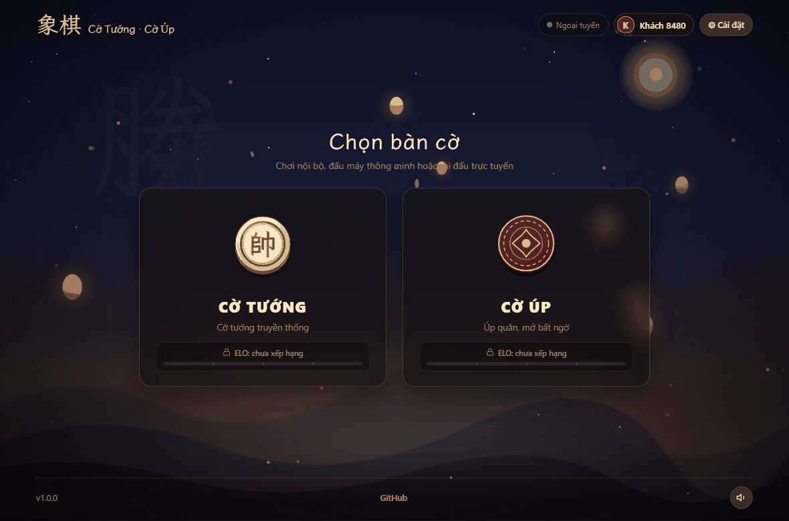 | 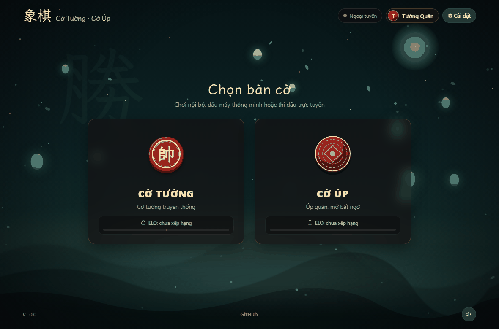 |
| 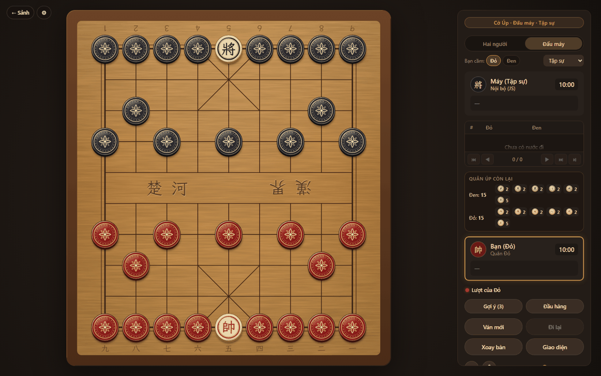 | 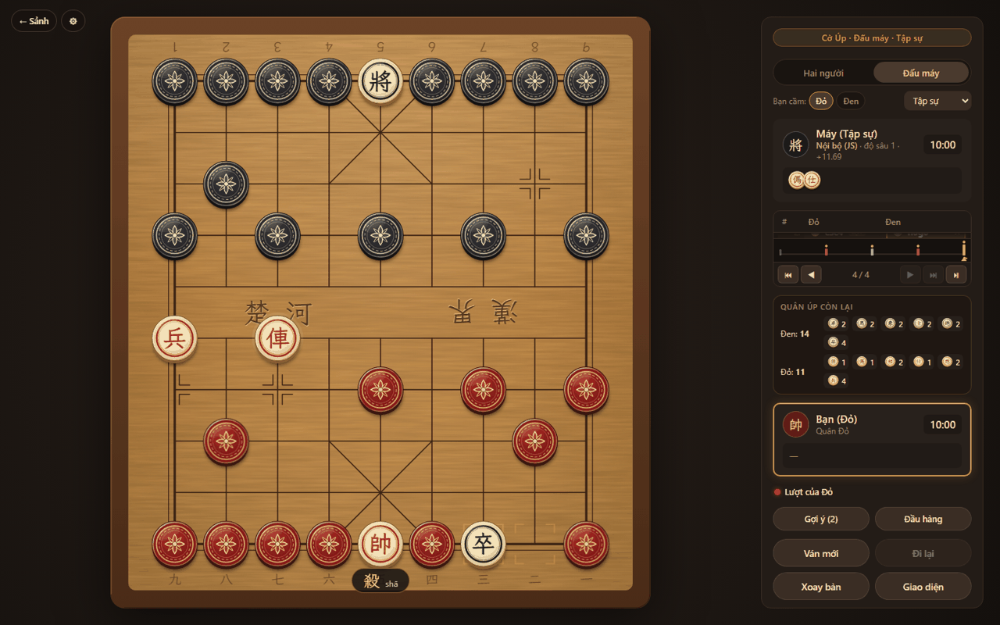 |
| 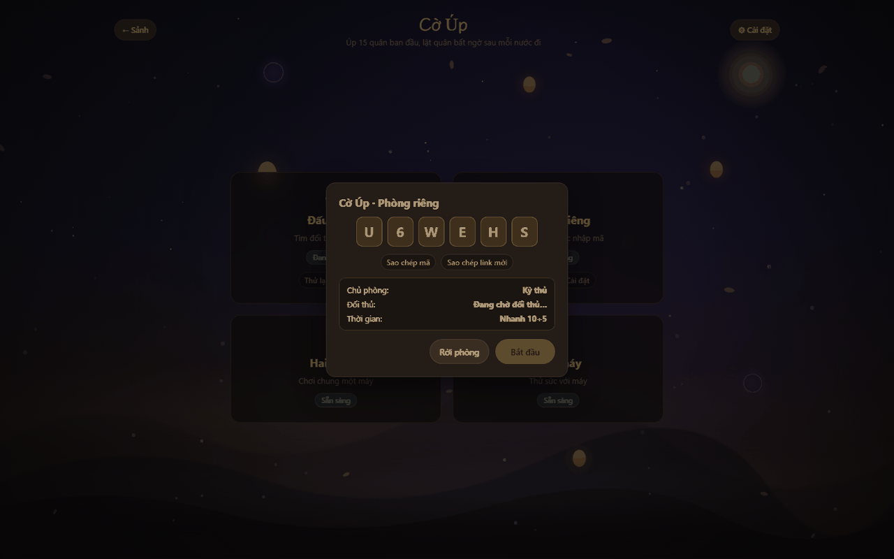 | 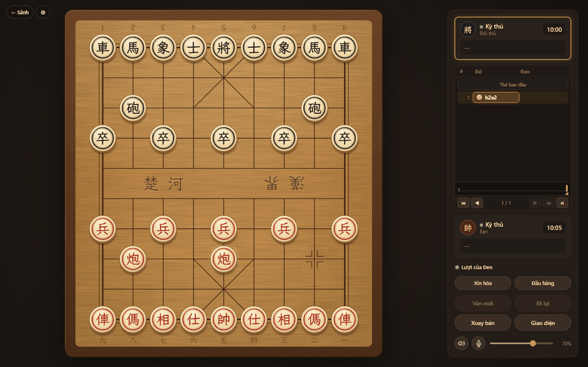 |

## Mục lục
- [Tính năng](#tính-năng)
- [Chạy nhanh](#chạy-nhanh)
- [Chơi với Pikafish (tùy chọn)](#chơi-với-pikafish-tùy-chọn)
- [Giọng hô tiếng Trung (tùy chọn)](#giọng-hô-tiếng-trung-tùy-chọn)
- [Chơi trên điện thoại và máy tính bảng](#chơi-trên-điện-thoại-và-máy-tính-bảng)
- [Cách chơi](#cách-chơi)
- [Cấu trúc dự án](#cấu-trúc-dự-án)
- [Kiến trúc](#kiến-trúc)
- [Kiểm thử](#kiểm-thử)
- [Tùy chỉnh](#tùy-chỉnh)
- [Giới hạn đã biết](#giới-hạn-đã-biết)
- [Hướng phát triển](#hướng-phát-triển)
- [Giấy phép và ghi công](#giấy-phép-và-ghi-công)

## Tính năng

**Sảnh chờ, Cờ Úp (Jieqi) & Đấu Online**
- **Sảnh chờ "Đêm hội đèn lồng bên sông"**: nền Canvas 2D động theo theme (`Gỗ Lim` / `Ngọc Bích`), chọn trò chơi (Cờ Tướng / Cờ Úp), chọn chế độ, cài đặt hợp nhất (`xq_settings_v1`, lưu cả theme), tối ưu từ desktop tới màn hình 360 px.
- **Cờ Úp (Jieqi)**: đầy đủ luật Cờ Úp ([`docs/RULES_JIEQI.md`](docs/RULES_JIEQI.md)) — 15 quân úp mỗi bên đi theo vị trí giả rồi lật khi di chuyển, Sĩ đi chéo toàn bàn, Tượng qua sông (vẫn cản mắt), bảng **Quân úp còn lại**, hiệu ứng lật quân, âm thanh lật theo ngũ cung, và máy **PIMC** chạy trong Web Worker (không bao giờ nhìn trộm quân úp).
- **Đấu Online (Cờ Tướng & Cờ Úp)**: máy chủ Node + `ws` uy quyền ([`docs/PROTOCOL.md`](docs/PROTOCOL.md), [`docs/DEPLOY.md`](docs/DEPLOY.md)) hỗ trợ ghép trận nhanh, phòng riêng mã 6 ký tự + link mời `#/join/<CODE>`, đồng hồ đếm ngược, tự kết nối lại khi tải lại trang, xin hòa / đầu hàng / tái đấu đổi màu.

**Lưu, xuất và nhập ván**
- **Tự động lưu & Tiếp tục**: ván nội bộ và đấu máy tự động lưu vào IndexedDB (`xq_games_v1`), hiện thanh **Tiếp tục ván đang chơi** ngoài sảnh khi tải lại trang; ván kết thúc (kể cả đấu online) tự động lưu vào **Thư viện ván** (`#/library`, tối đa 200 ván, lọc theo biến thể/kết quả, tìm kiếm, ghi chú, hình thu nhỏ SVG vẽ lười).
- **Xuất & Nhập đa định dạng** ([`docs/FORMATS.md`](docs/FORMATS.md)): hỗ trợ file `.xqgame.json` (kể cả gói sao lưu nhiều ván), văn bản dạng PGN (`.pgn` / `.txt` có ký hiệu lật quân `=N` và `x=R` cho Cờ Úp), sao chép FEN thế cờ hiện tại, kéo thả file trực tiếp vào sảnh, và **liên kết chia sẻ** nén `deflate-raw` (`#/replay?g=...`, giới hạn 6000 ký tự). Mọi file xuất đều chỉ chứa thông tin công khai (không bao giờ rò rỉ quân còn úp hay `guestId`).

| | | |
|---|---|---|
| 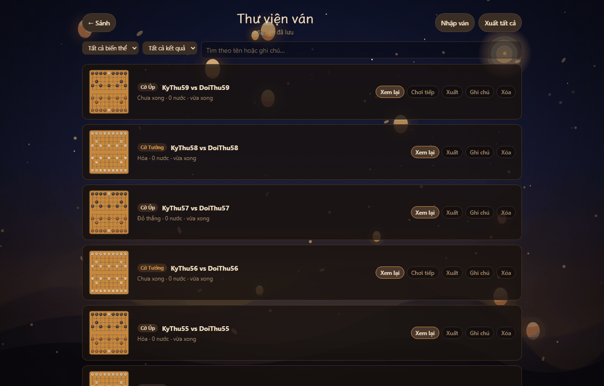 | 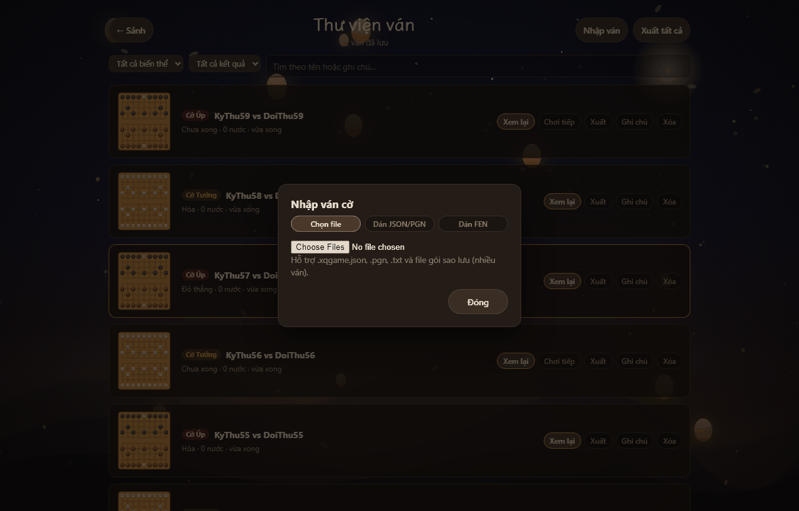 | 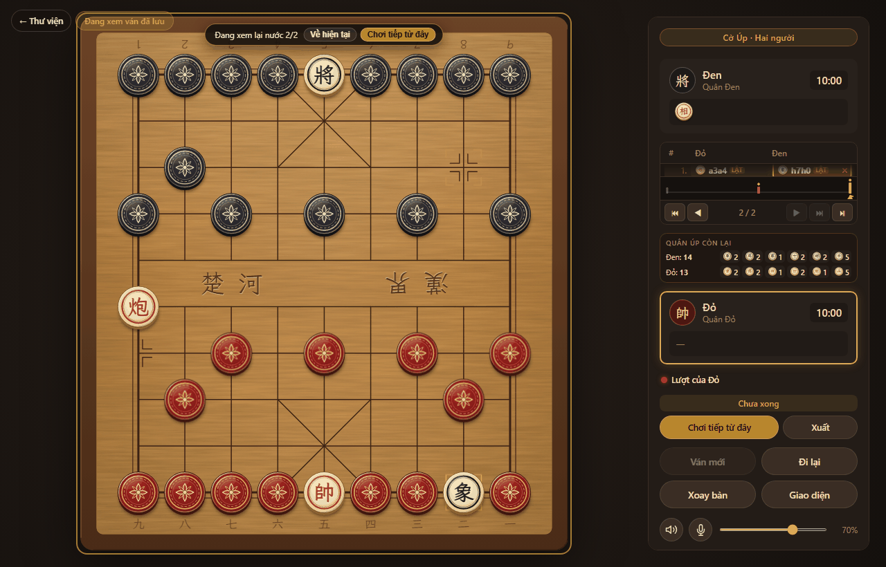 |

**Giao diện**
- Bàn cờ và 14 loại quân vẽ hoàn toàn bằng SVG (vân gỗ bằng `feTurbulence`, đổ bóng, vát cạnh, chữ Hán khắc nổi), nét sắc ở mọi độ phân giải (đã kiểm tra DPR 1, 1.5, 2).
- Hai theme: **Gỗ Lim** (ván gỗ ấm, quân ngà) và **Ngọc Bích** (bàn xanh đá, quân đỏ sơn mài chữ vàng), chuyển theme có hiệu ứng mờ dần.
- Kéo thả hoặc bấm-bấm để đi quân, nhấc quân, vòng chọn, đánh dấu nước vừa đi, quân nảy về khi đi sai, xoay bàn (chữ trên quân luôn đứng thẳng).
- Không có vòng lặp `requestAnimationFrame` khi không hoạt ảnh nên khi đứng yên gần như không tốn CPU.

**Luật cờ**
- Đầy đủ luật quân: Tướng, Sĩ, Tượng (bị cản mắt tượng, không qua sông), Mã (bị cản chân mã), Xe, Pháo (ăn qua đúng một quân làm ngòi), Tốt (qua sông mới đi ngang), tướng không được đối mặt.
- Nước đi hợp lệ phải không để tướng mình bị chiếu. Có chiếu, chiếu bí, hết nước đi (bên bị bí **thua**, đúng luật cờ tướng), hòa do lặp thế 3 lần, hòa do 60 nước không ăn quân.
- Kiểm tra bằng perft: 44 / 1.920 / 79.666 / 3.290.240 nước ở độ sâu 1 đến 4 từ thế xuất phát.
- Chế độ **"Đi tự do (luyện tập)"** để đi không cần luật.

**Chơi với máy**
- Chế độ **Hai người** hoặc **Đấu máy**; chọn cầm **Đỏ** hoặc **Đen**; 4 cấp: **Tập sự, Nghiệp dư, Cao thủ, Đại sư**.
- Hai engine: **Nội bộ (JS)** chạy trong Web Worker (negamax + alpha-beta, đào sâu dần, bảng băm Zobrist, tìm kiếm tĩnh, sắp xếp nước đi) và **Pikafish** (engine UCI rất mạnh) qua một cầu nối Python nhỏ.
- Gợi ý nước đi (mũi tên xanh, 3 lần mỗi ván), đi lại (lùi 2 nước khi đấu máy), đầu hàng, hiển thị độ sâu và điểm khi máy đang nghĩ.

**Xem lại ván**
- Bấm vào bất kỳ nước nào trong danh sách (hoặc **Thế ban đầu**, số thứ tự hàng `#`) để xem thế cờ lúc đó; nút `⏮ ◀ ▶ ⏭ ⏯`, tự phát lại mỗi 800 ms, phím tắt, thanh thời gian kéo được (vạch đỏ/đen, chấm vàng cho nước ăn quân).
- **"Chơi tiếp từ đây"** để cắt ván về một thế cờ rồi đánh tiếp.
- Danh sách nước đi dạng thẻ có biểu tượng quân SVG, dấu ăn quân và chiếu, ẩn thanh cuộn mặc định với hiệu ứng mờ dần hai đầu.

**Âm thanh**
- Toàn bộ âm thanh được **tổng hợp bằng Web Audio**, không cần tải file: tiếng gỗ khi đi và ăn quân, chiêng đồng khi chiếu, chiêng và đàn tranh khi chiếu bí, trống trận, tiếng kiếm va chạm khi kết thúc ván.
- Có thể thay bằng file thu thật (xem [`assets/sounds/README.md`](assets/sounds/README.md)).
- Giọng hô tiếng Trung (請, 吃, 殺, 將軍, 將死, 承讓, 和棋) với bộ xử lý giọng "tướng quân" (EQ, bão hòa nhẹ, nén nhanh, vang sảnh ngắn). Xem phần giọng hô bên dưới.

**Hiệu ứng kết thúc ván**
- **Thắng**: "Song kiếm giao phong", quân tướng bị bí nứt vỡ, hai kiếm lao vào nhau, tia lửa và rung màn hình, chữ **勝** hiện như mực loang, con dấu **將** đóng xuống.
- **Thua**: "Bại trận", bàn cờ mất màu, quân tướng đổ, một kiếm cắm xuống bàn, chữ **敗**, tro tàn rơi. Đầu hàng thì cắm cờ trắng phất bay, chữ **投降**.
- **Hòa**: "Hạ kiếm", hai kiếm chạm mũi nhẹ rồi bắt chéo nằm yên trước vòng Thái Cực, sương mỏng, chữ **和**.
- Xem thử tất cả tại `/?effects`.

| | | |
|---|---|---|
| 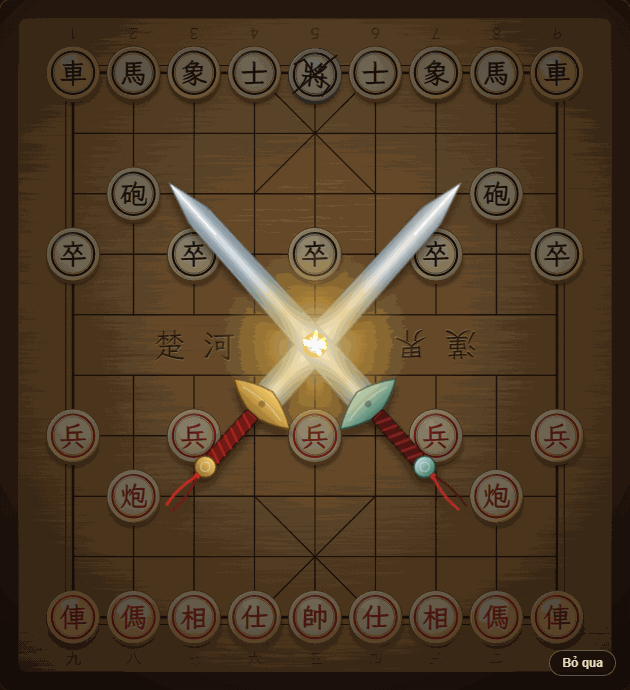 | 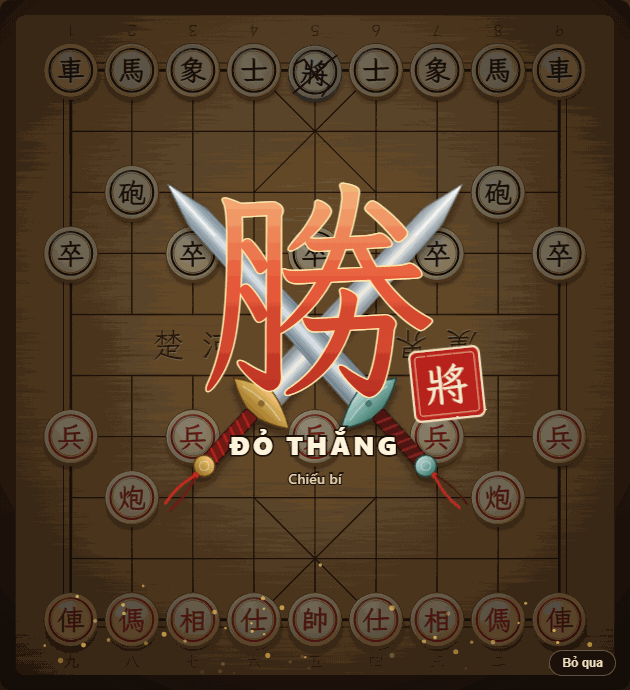 | 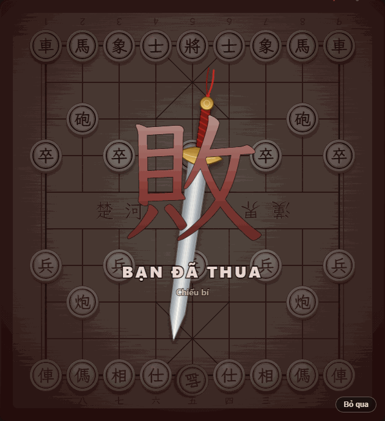 |
| 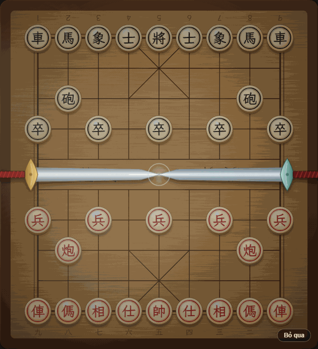 |  | 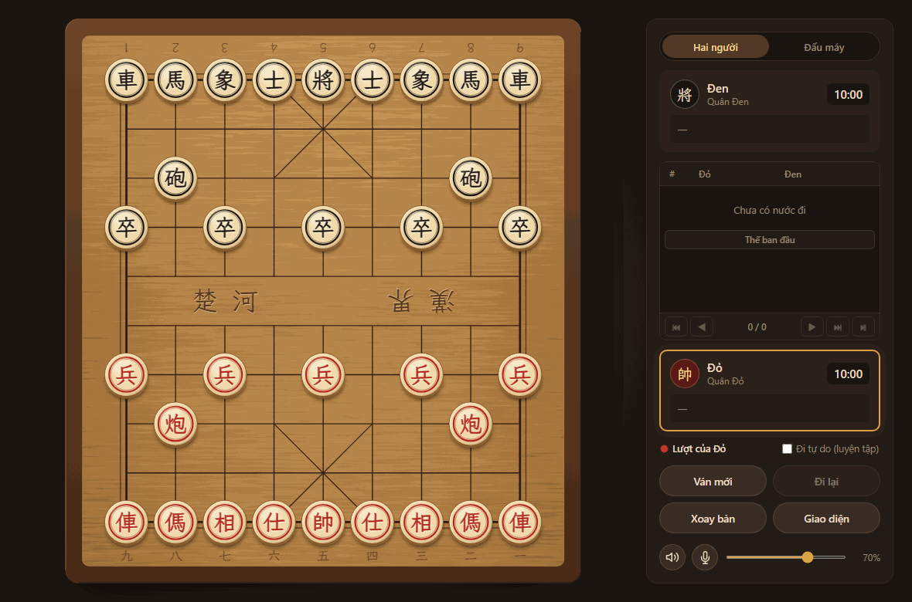 |

## Chạy nhanh

**Yêu cầu:** Python 3.10 trở lên và một trình duyệt hiện đại (Chrome, Edge, Firefox). Không cần `npm install`, không cần build. Node.js (≥ 18) chỉ cần nếu muốn chạy unit test.

```powershell
git clone https://github.com/TuLeTanh/ChineseChess.git
cd ChineseChess
python tools/server.py --port 8000
```

Mở http://localhost:8000. Trên Windows có thể bấm đúp `run.bat`.

**Chạy kèm máy chủ Online (tất cả trong một, Cờ Tướng + Cờ Úp + Đấu Online):**

```powershell
cd server
npm install
cd ..
node server/index.js          # mở http://127.0.0.1:8787
node server/index.js --lan    # chơi qua mạng LAN (lắng nghe 0.0.0.0:8787)
```

Xem hướng dẫn triển khai Docker / VPS / PaaS tại [`docs/DEPLOY.md`](docs/DEPLOY.md).

> Không mở thẳng `index.html` bằng `file://`, vì trình duyệt chặn JavaScript module. `python -m http.server 8000` cũng chạy được game nhưng sẽ không có cầu nối Pikafish.

Nếu chưa cài Pikafish, game tự dùng engine **Nội bộ (JS)** và vẫn chơi đầy đủ.

## Chơi với Pikafish (tùy chọn)

Pikafish là engine cờ tướng mã nguồn mở rất mạnh, giao tiếp qua giao thức UCI. Game không kèm sẵn file chạy của Pikafish (vì giấy phép GPL v3 & dung lượng mạng NNUE ~50 MB), nên cần tải một lần:

```powershell
python tools/setup_engine.py   # tải bản phát hành mới nhất và file mạng NNUE, tự thử chạy
python tools/server.py --port 8000
```

Sau đó vào **Đấu máy** và chọn **Máy: Pikafish**. Cầu nối `tools/server.py` chỉ lắng nghe `127.0.0.1`, kiểm tra chặt dữ liệu vào (FEN, nước đi, header `Host`, giới hạn 64 KB) trước khi gửi cho engine, và tự tắt tiến trình engine khi thoát.

Một số lưu ý:
- Cần mạng ở lần cài đầu tiên (và cần `7z` nếu bản phát hành đóng gói `.7z`). Sau đó chạy hoàn toàn offline.
- Nếu `setup_engine.py` báo lỗi: kiểm tra Windows Security có cách ly file `.exe` không, và máy có Microsoft Visual C++ Redistributable (x64) chưa. Script sẽ in nguyên nhân cụ thể và ghi log vào `logs/setup_engine.log`.
- Đường dẫn thư mục chứa dấu tiếng Việt đã được xử lý tự động (`tools/engine_launch.py`).
- Kiểm tra trạng thái: http://localhost:8000/api/engine/info.

**Bảng cấp độ chơi với máy**

| Cấp độ | Engine Nội bộ (JS) (`js/ai/levels.js`) | Pikafish (`js/ai/levelsPikafish.js`) |
|---|---|---|
| **Tập sự** | `maxDepth: 2`, `150 ms`, chọn ngẫu nhiên top 4 trong `120 cp`, `12%` sai sót | `depth: 2`, `MultiPV: 6`, cửa sổ `200 cp` |
| **Nghiệp dư** | `maxDepth: 4`, `500 ms`, chọn ngẫu nhiên top 8 trong `30 cp` | `depth: 6`, `MultiPV: 4`, cửa sổ `50 cp` |
| **Cao thủ** | `maxDepth: 8`, `2500 ms`, bảng chuyển vị đầy đủ | `movetime: 1500 ms`, `MultiPV: 1` |
| **Đại sư** | `maxDepth: 12`, `6000 ms`, bảng chuyển vị đầy đủ | `movetime: 6000 ms`, `MultiPV: 1`, đa luồng |
| **Gợi ý** | `maxDepth: 8`, `1200 ms` | `movetime: 1000 ms`, `MultiPV: 1` |

## Giọng hô tiếng Trung (tùy chọn)

Repo **không chứa** file giọng (`assets/voice/*.mp3` và `manifest.json`). Chúng được sinh bằng `edge-tts` (dùng dịch vụ đọc văn bản của Microsoft theo cách không chính thức), nên chỉ nên tạo cho mục đích cá nhân:

```powershell
pip install edge-tts
python tools/gen_voice.py            # cần mạng một lần, tạo assets/voice/*.mp3 và manifest.json
```

Chưa tạo giọng thì game dùng giọng đọc có sẵn của trình duyệt (`speechSynthesis`) nếu có giọng tiếng Trung, nếu không thì chỉ phát âm thanh nhạc cụ và gỗ. Muốn đổi giọng, độ trầm, tốc độ: `python tools/gen_voice.py --help`. Muốn dùng giọng tự thu: xem [`assets/voice/README.md`](assets/voice/README.md).
Nghe thử các giọng tại `/?voices`, nghe toàn bộ âm thanh tại `/?sounds`.

## Chơi trên điện thoại và máy tính bảng

Giao diện ván cờ hỗ trợ đầy đủ màn hình điện thoại (từ `320×568` trở lên) và máy tính bảng cả dọc lẫn ngang mà không thay đổi giao diện máy tính (`≥ 960×600`):

- **Bố cục tự động (`desktop` / `stack` / `side`)**:
  - **Dọc (`stack`)**: thanh trên gọn (`← Sảnh`, chế độ chơi, nút Lưu/Xuất `💾`, Cài đặt `⚙`), dải đối thủ, bàn cờ chiếm toàn chiều rộng (tự cắt khung gọn khi chiều rộng `< 480 px`), dải nước đi cuộn ngang + nút `⌃`, dải người chơi (kèm trạng thái lượt/chiếu), và thanh điều khiển dưới cùng vừa tầm ngón cái.
  - **Ngang (`side`)**: bàn cờ bên trái lớn nhất theo chiều cao, bảng thông tin + danh sách nước đi bên phải.
  - **Bảng trượt (Bottom Sheet)** ở bố cục dọc: kéo tay cầm lên/xuống hoặc bấm `⌃` để xem đầy đủ 3 mục **Nước đi** (kèm thanh thời gian kéo được bằng tay), **Quân úp** (Cờ Úp), và **Tùy chọn**.
- **Điều khiển cảm ứng**: hỗ trợ cả **chạm-chạm** và **kéo thả** (nhấc quân lên trên ngón tay để không bị che tầm nhìn, vòng vàng hút vào ô đích hợp lệ gần nhất, chặn đa chạm / phóng to nhầm / menu ngữ cảnh khi nhấn giữ, nảy về khi thả sai).
- **Ba tùy chọn mới trong Cài đặt → Trò chơi**:
  - *Rung khi chạm (nếu thiết bị hỗ trợ)*
  - *Nhấc quân lên trên ngón tay khi kéo*
  - *Giữ màn hình sáng khi đang chơi* (Screen Wake Lock, chỉ chạy khi trình duyệt hỗ trợ trong ngữ cảnh bảo mật)

| | | | |
|---|---|---|---|
| 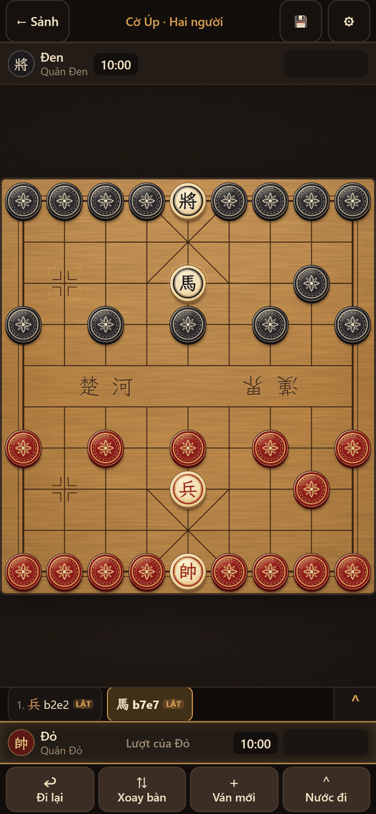 | 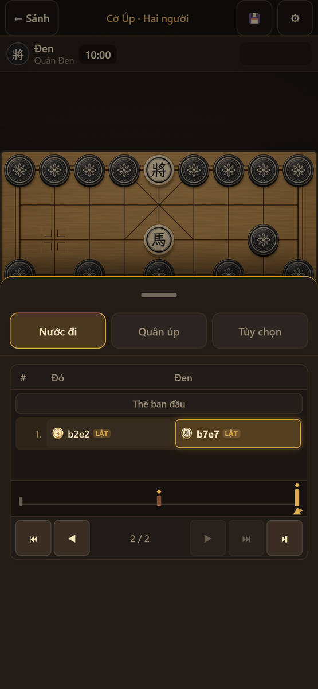 | 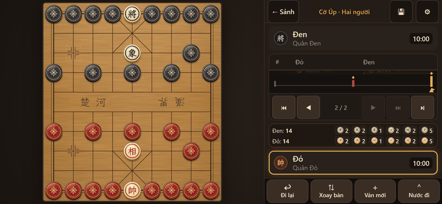 | 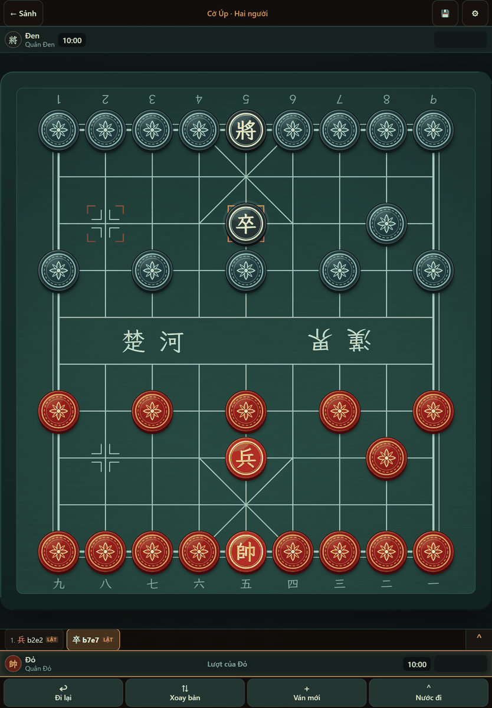 |

**Thử chơi trên điện thoại thật qua mạng LAN (cùng Wi-Fi):**

```powershell
cd server
npm install    # chỉ cần chạy một lần
cd ..
node server/index.js --lan
```

1. Xem địa chỉ IP nội bộ của máy tính (Windows: `ipconfig`, mục **IPv4 Address**, ví dụ `192.168.1.25`).
2. Trên điện thoại cùng Wi-Fi, mở trình duyệt (Safari / Chrome) tới `http://<IP máy tính>:8787` (ví dụ `http://192.168.1.25:8787`).
3. **Lưu ý tường lửa**: nếu điện thoại không tải được trang, cho phép cổng TCP `8787` (hoặc `node.exe`) qua Windows Firewall trên mạng Private.
4. **Lưu ý Pikafish**: engine Pikafish chỉ chạy qua `tools/server.py` trên máy tính (`127.0.0.1`); khi mở qua `node server/index.js --lan` trên điện thoại, game tự dùng engine **Nội bộ (JS)** chạy trực tiếp trên thiết bị và vẫn chơi đầy đủ Cờ Tướng, Cờ Úp, Đấu Online và Thư viện ván.

## Cách chơi

- **Chế độ chơi**: chọn **Hai người** hoặc **Đấu máy** ở đầu bảng phải.
- **Đấu máy**: chọn **Bạn cầm: Đỏ / Đen** (chọn Đen sẽ tự xoay bàn và máy đi trước), chọn cấp độ (`Tập sự` → `Đại sư`), và chọn **Máy: Pikafish** hoặc **Nội bộ (JS)**.
- **Trợ giúp & điều khiển**: **Gợi ý (3)** vẽ mũi tên xanh nước đi tối ưu (3 lần/ván), **Đầu hàng** kết thúc ván với hiệu ứng cờ trắng, **Đi lại** lùi 1 nước (Hai người) hoặc 2 nước (Đấu máy), **Ván mới**, **Xoay bàn**, **Sảnh chờ, Cờ Úp (Jieqi) & Đấu Online**
- **Sảnh chờ "Đêm hội đèn lồng bên sông"**: nền Canvas 2D động theo theme (`Gỗ Lim` / `Ngọc Bích`), chọn trò chơi (Cờ Tướng / Cờ Úp), chọn chế độ, cài đặt hợp nhất (`xq_settings_v1`, lưu cả theme), tối ưu từ desktop tới màn hình 360 px.
- **Cờ Úp (Jieqi)**: đầy đủ luật Cờ Úp ([`docs/RULES_JIEQI.md`](docs/RULES_JIEQI.md)) — 15 quân úp mỗi bên đi theo vị trí giả rồi lật khi di chuyển, Sĩ đi chéo toàn bàn, Tượng qua sông (vẫn cản mắt), bảng **Quân úp còn lại**, hiệu ứng lật quân, âm thanh lật theo ngũ cung, và máy **PIMC** chạy trong Web Worker (không bao giờ nhìn trộm quân úp).
- **Đấu Online (Cờ Tướng & Cờ Úp)**: máy chủ Node + `ws` uy quyền ([`docs/PROTOCOL.md`](docs/PROTOCOL.md), [`docs/DEPLOY.md`](docs/DEPLOY.md)) hỗ trợ ghép trận nhanh, phòng riêng mã 6 ký tự + link mời `#/join/<CODE>`, đồng hồ đếm ngược, tự kết nối lại khi tải lại trang, xin hòa / đầu hàng / tái đấu đổi màu.

**Lưu, xuất và nhập ván**
- **Tự động lưu & Tiếp tục**: ván nội bộ và đấu máy tự động lưu vào IndexedDB (`xq_games_v1`), hiện thanh **Tiếp tục ván đang chơi** ngoài sảnh khi tải lại trang; ván kết thúc (kể cả đấu online) tự động lưu vào **Thư viện ván** (`#/library`, tối đa 200 ván, lọc theo biến thể/kết quả, tìm kiếm, ghi chú, hình thu nhỏ SVG vẽ lười).
- **Xuất & Nhập đa định dạng** ([`docs/FORMATS.md`](docs/FORMATS.md)): hỗ trợ file `.xqgame.json` (kể cả gói sao lưu nhiều ván), văn bản dạng PGN (`.pgn` / `.txt` có ký hiệu lật quân `=N` và `x=R` cho Cờ Úp), sao chép FEN thế cờ hiện tại, kéo thả file trực tiếp vào sảnh, và **liên kết chia sẻ** nén `deflate-raw` (`#/replay?g=...`, giới hạn 6000 ký tự). Mọi file xuất đều chỉ chứa thông tin công khai (không bao giờ rò rỉ quân còn úp hay `guestId`).

| | | |
|---|---|---|
|  |  |  |

**Giao diện** (đổi giữa Gỗ Lim và Ngọc Bích).
- **Luyện tập**: bật **Đi tự do (luyện tập)** (trong chế độ Hai người) để đặt quân tự do không kiểm tra luật.
- **Âm thanh**: thanh loa ở cuối bảng phải để tắt/bật âm thanh, bật/tắt giọng hô và chỉnh âm lượng.

**Phím tắt**

| Phím | Chức năng |
|---|---|
| `Ctrl + Z` | Đi lại nước vừa đi (nếu đang xem lại thì tự về hiện tại trước) |
| `N` | Bắt đầu ván mới |
| `F` | Xoay bàn cờ 180° (chữ trên quân luôn đứng thẳng) |
| `M` | Tắt / bật toàn bộ âm thanh |
| `V` | Bật / tắt giọng hô tiếng Trung |
| `←` / `→` | Xem nước trước / nước sau trong lịch sử |
| `Home` / `End` | Nhảy về thế ban đầu / về nước hiện tại |
| `Space` | Tự động phát / tạm dừng xem lại (mỗi 800 ms) |
| `Esc` | Đóng hộp thoại / bỏ qua hiệu ứng / thoát xem lại / hủy chọn quân |

**Các trang xem thử**

| URL | Dùng để |
|---|---|
| `/` | Chơi game |
| `/?gallery` | Xem 14 quân cờ ở nhiều cỡ |
| `/?preview=board\|pieces\|pieces_small\|start` | Ảnh tĩnh để chụp màn hình |
| `/?sounds` | Bảng nghe mọi âm thanh tổng hợp & giọng hô |
| `/?voices` | Nghe thử các giọng hô audition |
| `/?effects` | Xem thử hiệu ứng thắng, thua, đầu hàng, hòa (chỉnh tốc độ 0.25×–2×) |

## Cấu trúc dự án

```text
ChineseChess/
├─ index.html                  # Trang chính
├─ run.bat                     # Khởi chạy nhanh trên Windows (chạy tools/server.py)
├─ DESIGN.md                   # Đặc tả giao diện, hình học bàn cờ & bảng màu
├─ README.md                   # Tài liệu dự án
├─ css/
│  └─ style.css                # Giao diện, bảng phải, danh sách nước đi & hiệu ứng
├─ js/
│  ├─ main.js                  # Điều phối ván đấu, review mode, phím tắt, trang phụ
│  ├─ theme.js                 # Hai theme: Gỗ Lim và Ngọc Bích
│  ├─ rules.js                 # RulesProvider, XiangqiRules và PermissiveRules
│  ├─ engine.js                # Giao diện trừu tượng Engine
│  ├─ model/                   # board.js (O(1) snapshots), fen.js, moves.js, piece.js
│  ├─ render/                  # boardSvg.js, pieceSvg.js
│  ├─ ui/                      # boardView.js, sidePanel.js, anim.js
│  ├─ ai/                      # client.js, worker.js, search.js, eval.js, movegen.js,
│  │                           # levels.js, pikafishClient.js, levelsPikafish.js
│  ├─ audio/                   # sfx.js, synth.js, voice.js
│  └─ fx/                      # endFx.js, swords.js, particles.js
├─ assets/
│  ├─ fonts/                   # LXGWWenKaiTC-Subset.ttf + LICENSE-OFL.txt
│  ├─ sounds/README.md         # Hướng dẫn thay âm thanh thu thật
│  └─ voice/README.md          # Hướng dẫn tạo hoặc thay giọng hô
├─ engine/
│  ├─ README.md                # Ghi chú bản quyền & cấu hình Pikafish
│  └─ LICENSE                  # Giấy phép GNU GPL v3 của Pikafish
├─ tests/                      # Unit test Node.js: model, rules (perft), ai, history
├─ tools/                      # server.py, setup_engine.py, engine_launch.py,
│                              # gen_voice.py, shot.py và các script verify_*.py
└─ docs/
   ├─ DECISIONS.md             # Quyết định kiến trúc
   ├─ PROGRESS.md              # Nhật ký phát triển
   ├─ PROMPTS.md               # Các prompt đã dùng để dẫn dắt trợ lý AI
   ├─ AUDIT.md                 # Báo cáo kiểm toán mã nguồn & kiểm thử cạnh tranh
   └─ screenshots/             # Ảnh minh họa cho README
```

## Kiến trúc

- **Giao diện tĩnh, không build:** HTML + CSS + ES modules + SVG, không framework, không CDN.
- **Tách trạng thái ván và trạng thái đang xem:** `Board` giữ mảng `snapshots` O(1) theo từng nước (FEN, nước đi, quân bị ăn, cờ chiếu); chế độ xem lại chỉ đổi `viewPly` và dựng bảng hiển thị chỉ đọc nên không bao giờ làm hỏng ván thật.
- **Giao diện luật (`RulesProvider`)** với hai cài đặt: `XiangqiRules` (luật thật) và `PermissiveRules` (đi tự do). Engine JS có `movegen.js` riêng dùng mảng phẳng `Int8Array(90)` đã kiểm chứng trùng khớp PERFT với `XiangqiRules`.
- **Engine JS** chạy trong Web Worker (`js/ai/worker.js`) để không làm đơ giao diện; mọi nước máy trả về đều được kiểm tra lại bằng luật trước khi đi.
- **Cầu nối Pikafish:** `tools/server.py` (chỉ dùng thư viện chuẩn của Python) giữ một tiến trình engine qua `tools/engine_launch.py`, nhận yêu cầu JSON qua HTTP, đẩy thông tin độ sâu và điểm qua Server-Sent Events (`/api/engine/stream`).
- **Âm thanh:** sinh bằng Web Audio (`OfflineAudioContext`), có bus riêng cho hiệu ứng, chiêng và giọng nói, cùng bộ giới hạn (limiter) ở ngõ ra.
- **Hiệu ứng kết thúc ván:** mọi hoạt ảnh là hàm thuần của thời gian `render(t)` (hạt giống ngẫu nhiên cố định), hỗ trợ `window.__fxSeek(ms)` trong `?test` để chụp ảnh kiểm tra, và vòng lặp `requestAnimationFrame` tự dừng hoàn toàn khi xong.

Chi tiết quyết định thiết kế: [`docs/DECISIONS.md`](docs/DECISIONS.md). Bản thiết kế giao diện: [`DESIGN.md`](DESIGN.md).

## Kiểm thử

```powershell
node --test tests/core-import.test.js tests/rules.test.js tests/ai.test.js tests/jieqi.test.js tests/jieqiAi.test.js tests/online/server.test.js
python tools/verify.py                  # kiểm tra giao diện, luật, review mode bằng Playwright
python tools/verify_lobby.py            # sảnh chờ, cài đặt, responsive 360 px, rò rỉ bộ nhớ
python tools/verify_jieqi.py            # Cờ Úp: quân úp, lật quân, bảng quân còn lại, AI PIMC
python tools/verify_online.py           # 2 trình duyệt: ghép trận, phòng riêng, kết nối lại, Cờ Úp online
python tools/verify_sound.py            # đo 19 âm thanh tổng hợp (gồm reveal) & chuỗi capture+check
python tools/verify_voice.py            # đo file giọng (cần đã chạy gen_voice.py)
python tools/verify_fx.py               # hiệu ứng kết thúc ván (48 khung hình, rAF, skip)
python tools/verify_engine.py           # Pikafish và cầu nối (cần đã chạy setup_engine.py)
python tools/verify_races.py            # kiểm thử tình huống cạnh tranh (race conditions)
```

Yêu cầu cho các script kiểm thử trình duyệt (`tools/verify*.py`): cài Playwright một lần bằng `pip install playwright` và `playwright install chromium`. Unit test (`node --test`) cần Node.js ≥ 18 và chạy độc lập không cần trình duyệt. `verify_voice.py` chỉ chạy sau khi đã tạo giọng (`tools/gen_voice.py`); `verify_engine.py` chỉ chạy sau khi đã cài Pikafish (`tools/setup_engine.py`).

## Tùy chỉnh

| Muốn chỉnh | Tệp | Hằng số chính |
|---|---|---|
| Cấp độ engine JS | `js/ai/levels.js` | `AI_LEVELS`, `HINT_LEVEL` |
| Cấp độ Pikafish | `js/ai/levelsPikafish.js` | `PIKAFISH_LEVELS` |
| Hàm đánh giá thế cờ JS | `js/ai/eval.js` | Điểm quân & bảng vị trí (PST) |
| Tỷ lệ âm lượng các bus | `js/audio/sfx.js` | `SFX_BUS_GAIN`, `GONG_GAIN`, `VOICE_BUS_GAIN` |
| Mốc thời gian hiệu ứng kết thúc | `js/fx/endFx.js` | `FX_TIMINGS` |
| Màu sắc, vân gỗ, theme | `js/theme.js` | `THEME_GO_LIM`, `THEME_NGOC_BICH` |

## Giới hạn đã biết

- Chưa có luật xử lý **chiếu liên tục** (trường chiếu, trường tróc) hay đuổi quân liên tục. Hiện lặp thế 3 lần được xử hòa; Pikafish có luật lặp riêng nên có thể khác kết quả của game trong vài thế đặc biệt.
- **Chưa là PWA** (chưa có `manifest.json` / Service Worker để cài đặt biểu tượng màn hình chính hay chạy ngoại tuyến hoàn toàn không cần máy chủ cục bộ).
- Âm thanh tổng hợp không thể giống hoàn toàn tiếng gỗ thật; có thể thay bằng file thu thật.
- Trên bản clone mới chưa chạy `tools/gen_voice.py`, trình duyệt có thể ghi 1 dòng `404` trong Console khi kiểm tra `assets/voice/manifest.json` (game vẫn hoạt động bình thường).
- Đổi cấp độ máy ngay khi máy đang nghĩ sẽ áp dụng từ nước tiếp theo (không hủy nước đang tính).
- Khi mở qua HTTP mạng LAN (`http://<IP>:8787`, không phải HTTPS), trình duyệt tắt `navigator.clipboard` và Screen Wake Lock — game tự chuyển sang hộp văn bản chọn-để-chép và bỏ qua Wake Lock một cách im lặng.

## Hướng phát triển

Ý tưởng tiếp theo: lưu và xuất ván (FEN, PGN), phân tích ván bằng Pikafish (thanh lợi thế, nước hay và nước sai), thư viện khai cuộc, chơi online hai người, luật chiếu liên tục, bố cục di động/cảm ứng, đóng gói thành ứng dụng desktop.

## Giấy phép và ghi công

**Mã nguồn của dự án này:** chưa chọn giấy phép; theo mặc định mọi quyền được bảo lưu cho tác giả cho đến khi có file `LICENSE`.

**Thành phần của bên thứ ba:**

| Thành phần | Dùng để | Giấy phép | Có trong repo? |
|---|---|---|---|
| [LXGW WenKai TC](https://github.com/lxgw/LxgwWenKaiTC) (bản đã cắt chữ) | Chữ Hán trên quân cờ và bàn cờ | SIL Open Font License 1.1 | Có, bản đã cắt chữ kèm giấy phép trong `assets/fonts/` |
| [Pikafish](https://github.com/official-pikafish/Pikafish) | Engine mạnh | GNU GPL v3 | Không. Tải bằng `tools/setup_engine.py`; `engine/LICENSE` là bản GPL v3 |
| Mạng NNUE của Pikafish | Hàm đánh giá của Pikafish | Điều khoản riêng của dự án Pikafish (không dùng thương mại khi chưa được phép) | Không, tải bằng script |
| `edge-tts` | Tạo file giọng một lần | Thư viện LGPL; dịch vụ đọc của Microsoft theo điều khoản của Microsoft | Không chứa file giọng |
| [`ws`](https://github.com/websockets/ws) | Máy chủ WebSocket online (`server/`) | MIT License | Chỉ khai báo trong `server/package.json` (`node_modules/` bị bỏ qua) |

Nếu bạn phân phối game cùng với file chạy của Pikafish thì phải tuân thủ GPL v3 (kèm giấy phép và mã nguồn hoặc đường dẫn tới mã nguồn). Quân cờ, bàn cờ, âm thanh nhạc cụ và hiệu ứng trong repo đều do chính dự án tự vẽ và tự tổng hợp bằng code, không dùng tài nguyên bên ngoài.

## Ghi chú

Dự án được xây dựng cùng trợ lý AI (soạn bản thiết kế và prompt bằng Claude, lập trình bằng agent trong Antigravity IDE). Các prompt đã dùng nằm trong [`docs/PROMPTS.md`](docs/PROMPTS.md).
